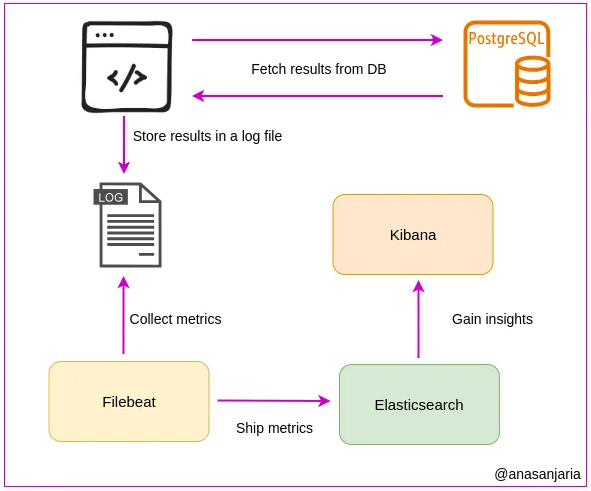

# Monitor Postgres using custom query



Many articles recommend using custom queries to track specific PostgreSQL metrics. For example, the
[AWS blog](https://aws.amazon.com/blogs/database/understanding-autovacuum-in-amazon-rds-for-postgresql-environments/) 
suggests the following query to monitor dead tuples — a key indicator of table bloat:

```sql
SELECT 
  relname AS TableName ,
  n_live_tup AS LiveTuples,
  n_dead_tup AS DeadTuples ,
  last_autovacuum AS Autovacuum ,
  last_autoanalyze AS Autoanalyze
FROM pg_stat_user_tables;
```

While such queries are useful, there's often a gap when it comes to automating real-time monitoring of these 
custom metrics.

> How can we collect these results as actionable data, integrate them into our monitoring system, and receive alerts 
> for potential performance issues?

This project bridges that gap by providing a system to automatically track PostgreSQL metrics, visualize them, and
trigger alerts when anomalies are detected.

## How to use?
```
docker-compose up -d
```

## How to use it in the production system?
- You need to run this [script](db-metric-collector.sh) as a cron on specific instance. It collects metrics at regular
interval and dump it in a file.
- These metrics will be shipped by `filebeat` to your `elasticsearch`
- You can visualize these metrics using `kibana`.
- Add watchers to inform team in case of any problem.

## Resource
Read complete article on [medium](https://medium.com/@anasanjaria/monitor-postgres-performance-using-custom-queries-1c06a766969b)
